# llm-tulpa
A chat assistant that runs on your own computer and can actually do things: read and write files, run commands, look things up on the web. It asks before it changes anything, and nothing leaves your machine.

<p align="center">
  <video src="./readme/tulpa-demo.mp4" width="300" controls muted loop playsinline></video>
</p>
<p align="center"><em>A minute of it: a chat that does things, any model, plugins installed without a restart, voice, and themes. <a href="./readme/tulpa-demo.mp4">Open the video</a> if it does not play here.</em></p>

<p align="center">
  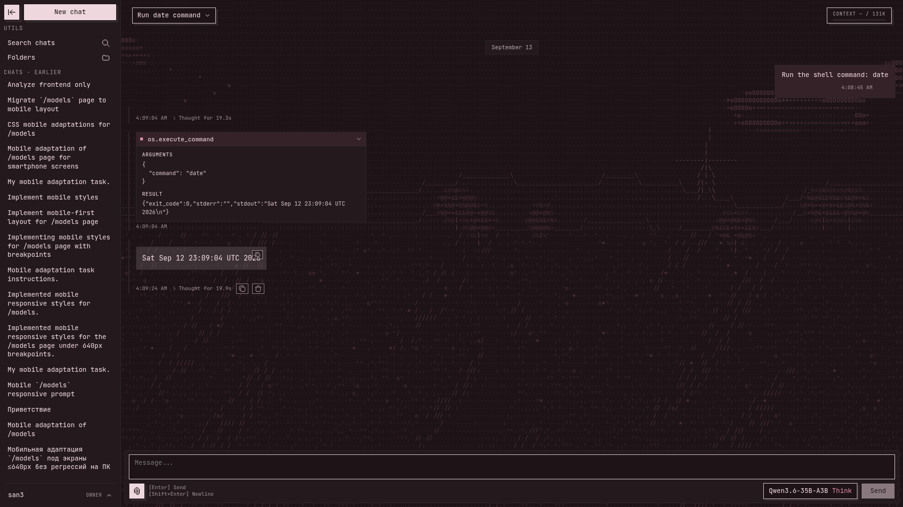
</p>
<p align="center"><em>Asked to read a project folder — the agent thinks about it (collapsed above), then stops to ask permission before running <code>storage.list_directory</code>.</em></p>

## What you get
- **A model that works with your files and your machine.** It reads and writes files, runs shell commands, downloads things and searches the web. Anything that could change or expose something asks you first (per folder for files, per site for web requests). Turn on auto-confirm in Settings when you want to let it work on its own.
- **Setup on screen.** One command starts everything, and a setup wizard picks the right llama.cpp build for your hardware, downloads it and helps you choose a model. No config files and no `llama-server` flags.
- **Long chats that keep working.** Old messages are folded into a summary before the model runs out of room, a run keeps going if you close the tab, and the model can hand long jobs to sub-agents or background jobs.
- **Images, files and voice.** Attach images and documents, or press the microphone and talk.
- **Plugins.** Chat with the agent from Telegram, Discord or VK. You can also write your own plugin in Python or Rust, as a separate program, and ask the model to install it for you ([`plugin-sdk/`](./plugin-sdk/README.md)).
- **Several people, one machine.** The owner adds users, and everyone's chats and settings are their own.
- **25 themes.** Everything runs on your hardware with no API keys.

The full list is in [`docs/features.md`](./docs/features.md).

## Quickstart
You need Docker.
```bash
git clone https://github.com/SAANN3/llm-tulpa
cd llm-tulpa
./start-docker.sh
```
Open `http://localhost:5173` and follow the setup wizard: it asks for a name and password for the owner account, looks at your hardware, installs llama.cpp and has you pick a model.

**A model.** Anything llama.cpp can run that supports tool calling works. This project was built against [Qwen3.6-35B-A3B](https://huggingface.co/unsloth/Qwen3.6-35B-A3B-GGUF) (the `UD-Q4_K_XL` quant). Put a `.gguf` in `llm/`, or search and download one on the app's Models page.

**Want it faster?** Inside Docker llama.cpp runs several times slower than on the host (about 25 tokens/s against 70–100 on one 16 GB AMD card). Run the backend on the host instead:
```bash
./start-native.sh
```
It keeps the database, search and frontend in Docker and runs the backend with `cargo run --release` (the first build takes a few minutes). More about both ways, the wizard and the settings file: [`docs/getting-started.md`](./docs/getting-started.md).

## Screenshots
| | | |
|:---:|:---:|:---:|
| 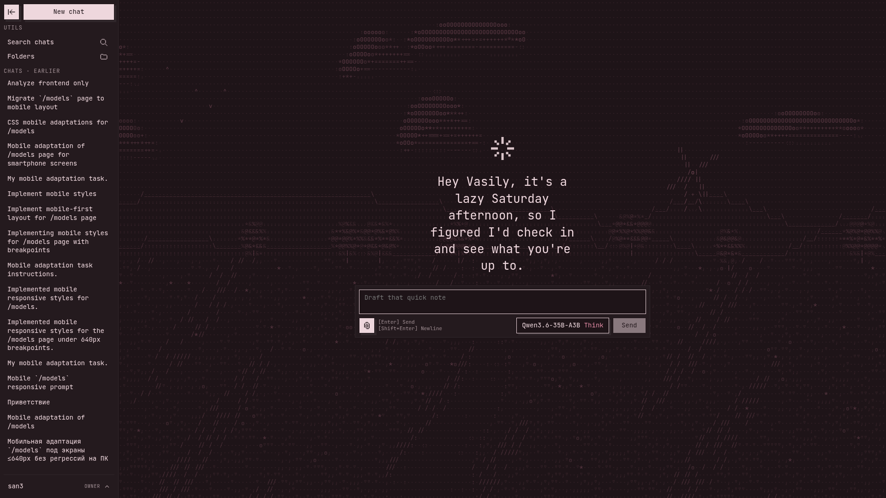<br><sub>Home — a fresh chat starts with a generated greeting, and the model for it can be picked right there.</sub> | 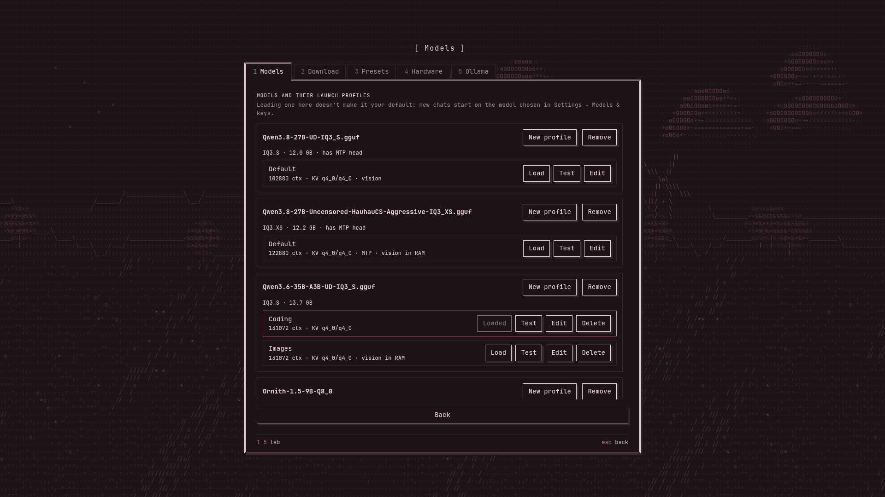<br><sub>Models — what is loaded and where it went, each model's launch profiles with Load, Test and Edit.</sub> | 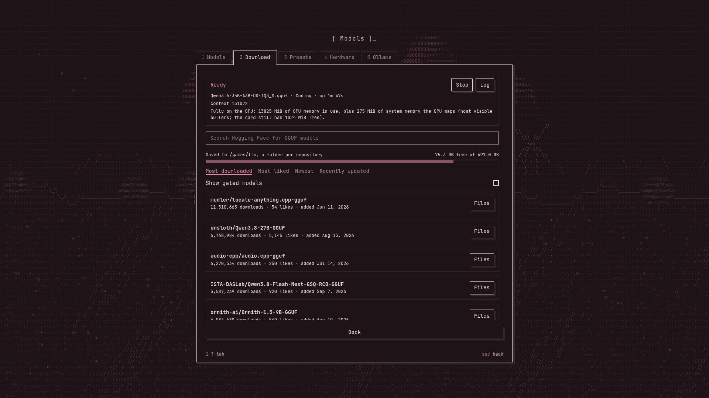<br><sub>Download — search Hugging Face and download into your model folder; the free space is shown.</sub> |
| 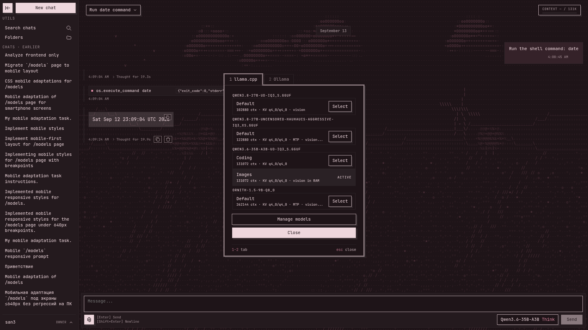<br><sub>Choose model — one chooser with a tab per provider, each launch profile with its settings.</sub> | 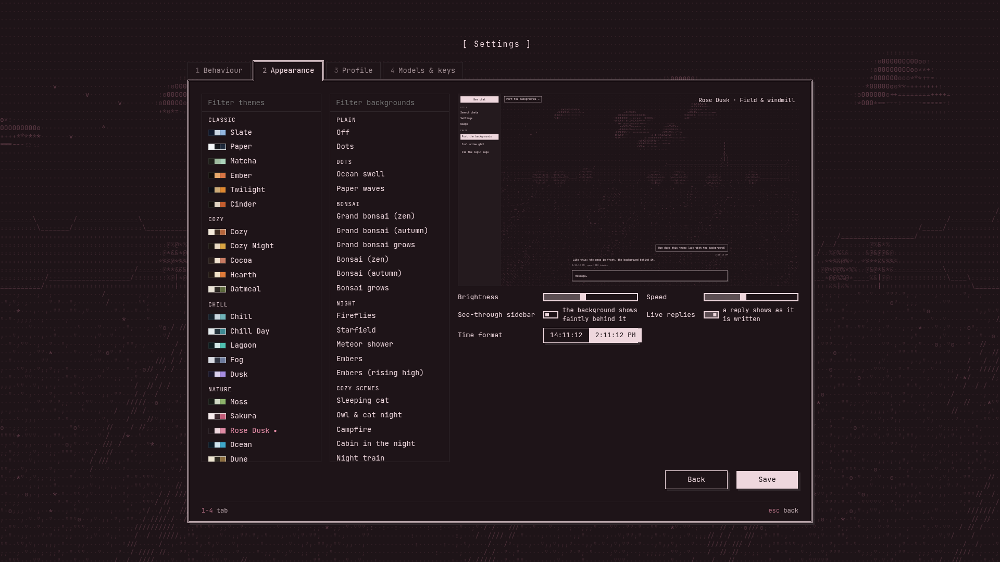<br><sub>Settings — the Appearance tab: themes and animated backgrounds, with a live preview of the page.</sub> | 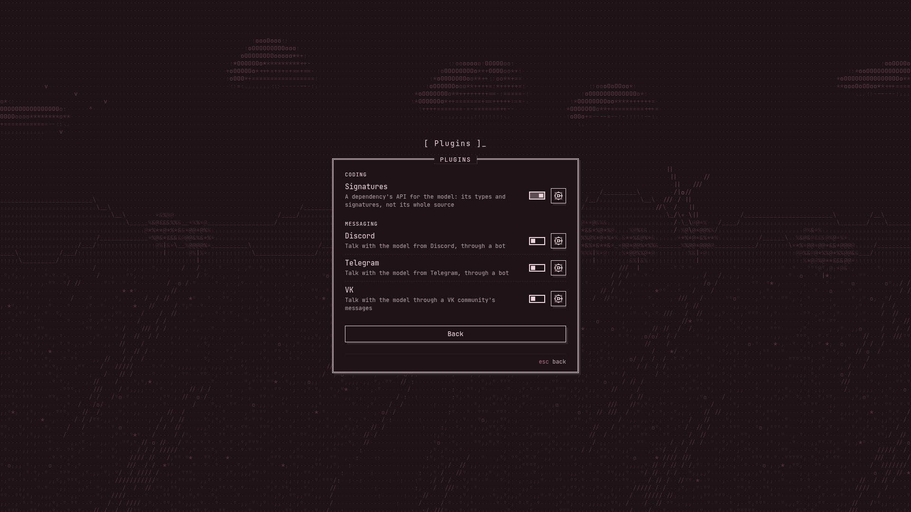<br><sub>Plugins — enable Telegram, Discord, or VK to talk to the agent from your own chat app, or install your own.</sub> |

On a phone the same pages reflow: the sidebar slides over the page, tabs scroll sideways, and a menu or dialog stays inside the screen.

| | | | |
|:---:|:---:|:---:|:---:|
| 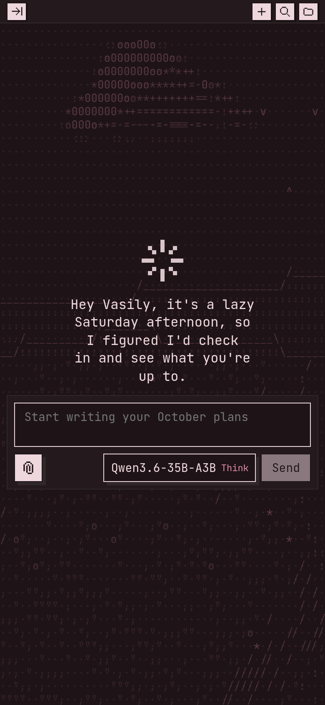<br><sub>Home</sub> | 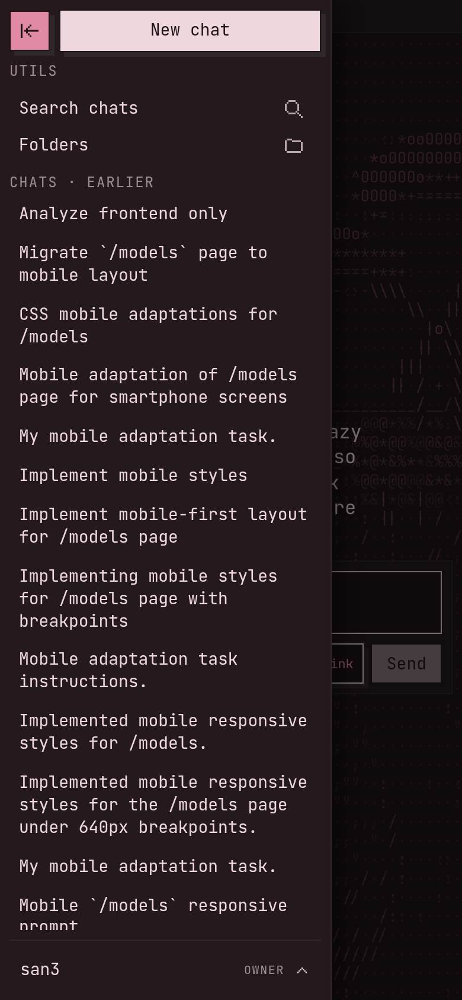<br><sub>The chat list</sub> | 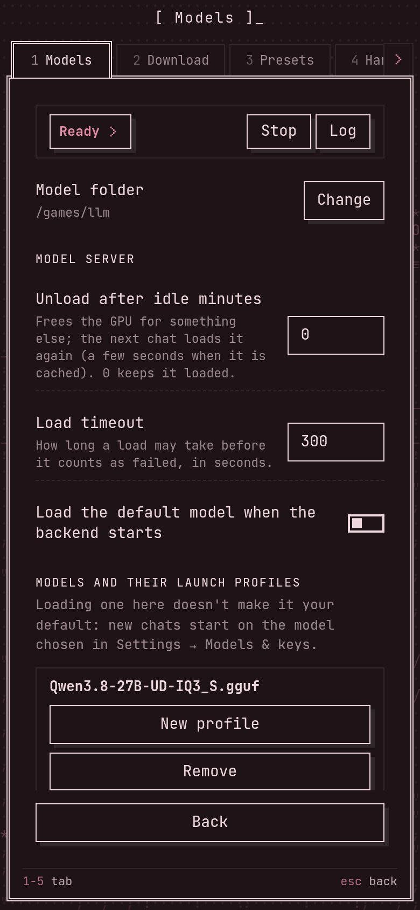<br><sub>Models</sub> | 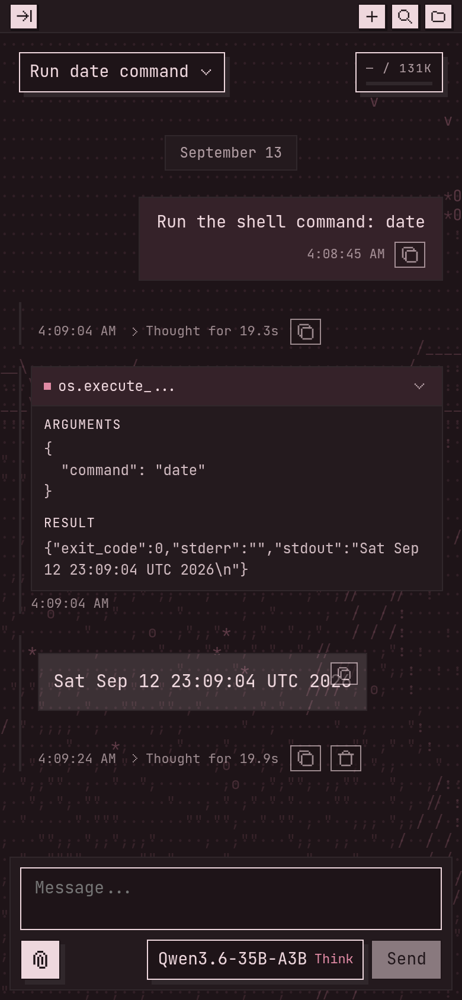<br><sub>A chat with a tool call</sub> |

## More
- [`docs/getting-started.md`](./docs/getting-started.md) — the model, the wizard, running natively.
- [`docs/voice-and-https.md`](./docs/voice-and-https.md) — the microphone, https, putting it behind your own domain.
- [`docs/features.md`](./docs/features.md) — every feature in detail.
- [`docs/benchmarks.md`](./docs/benchmarks.md) — why this model, and how fast it runs on an RX 6800.
- [`backend/README.md`](./backend/README.md), [`backend/TOOLS.md`](./backend/TOOLS.md), [`backend/PLUGINS.md`](./backend/PLUGINS.md) — the Rust backend, the tools, the plugin system.
- [`plugin-sdk/`](./plugin-sdk/README.md) — writing your own plugin.
- [`frontend/README.md`](./frontend/README.md) + [`frontend/THEMING.md`](./frontend/THEMING.md) — the React frontend and theming.
- [`llm/README.md`](./llm/README.md) — swapping models, changing the context window.
- [`CHANGELOG.md`](./CHANGELOG.md) — what changed, release by release.
- [`AGENTS.md`](./AGENTS.md) — for an AI coding agent working in this repo.

## License
Copyright (c) 2026 Blinov Vasily

This project is licensed under the MIT license ([LICENSE] or <http://opensource.org/licenses/MIT>)

[LICENSE]: ./LICENSE
