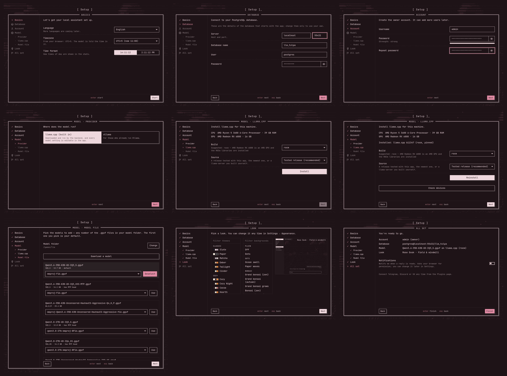

# llm-tulpa
A local-first LLM chat agent with real tool-calling — reads/writes files, inspects the machine it runs on, gated behind a permission system so nothing actually happens without your say-so. Rust/axum backend, React frontend, llama.cpp for inference (Ollama optional) — nothing leaves your machine.

<p align="center">
  
</p>
<p align="center"><em>Asked to read a project folder — the agent thinks about it (collapsed above), then stops to ask permission before running <code>storage.list_directory</code>.</em></p>

## Set up in the app, not in config files
llm-tulpa runs its own model server, and the setup happens on screen:
- **One command starts everything**, then a setup wizard takes over: the database, your owner account, a theme.
- **It looks at your hardware**, picks the llama.cpp build that suits it (CPU, Vulkan, ROCm or CUDA), tells you what library is missing if one is, and downloads and checks it for you.
- **Models come from a folder or from Hugging Face:** pick a `.gguf` you already have, or search and download one on the Models page, with your own Hugging Face token for gated ones.
- **Every model setting is a screen**, per model: context size, KV cache, GPU layers, MTP speculative decoding, the vision projector and where it runs, and sampling presets (temperature and friends) you can export and share.

No environment variables to set, no `llama-server` flags to remember, nothing to edit by hand for a normal install.

<p align="center">
  
</p>
<p align="center"><em>The whole setup, in order: a name and password, your hardware's llama.cpp build, and the model to start with.</em></p>

## Quickstart
```bash
git clone https://github.com/SAANN3/llm-tulpa
cd llm-tulpa
./start-docker.sh
```
Then open `http://localhost:5173` and follow the setup wizard. You need Docker; `./start-docker.sh` finds your GPU by itself.

The Docker image runs llama.cpp inside the container, which works on any GPU but is several times slower than running it on the host: about 25 tokens/s against 70–100 on one 16 GB AMD card with Qwen3.6-35B-A3B. For full speed run the backend on the host with `./start-native.sh` (see the details below).

<details>
<summary>The details: models, what the wizard asks, and running without Docker for full speed</summary>

**A model.** Anything llama.cpp can run that supports tool calling works, but this project was built and tested against **[Qwen3.6-35B-A3B](https://huggingface.co/unsloth/Qwen3.6-35B-A3B-GGUF)**, specifically the `UD-Q4_K_XL` quant (`Qwen3.6-35B-A3B-UD-Q4_K_XL.gguf`). Drop the `.gguf` in `llm/` (or a folder you point `MODEL_DIR` at), or search and download one from Hugging Face on the app's Models page. The app downloads and runs llama.cpp itself: the setup wizard looks at your hardware, installs the right build and has you pick the model file; every model setting (context, KV cache, GPU layers, MTP, vision projector, sampling) is editable in the app afterwards. Ollama still works as a second provider (`--profile ollama`; see [`llm/README.md`](./llm/README.md)).

**The wizard.** On first run, at `http://localhost:5173`, a setup wizard walks you through it — timezone, an **owner account** (username + password), the model server (it looks at your hardware, suggests the right llama.cpp build, downloads it — or uses a `llama-server` you point it at — and has you pick the model file), a theme, and notifications. With Postgres from the bundled compose file, the wizard's database step is one form (`localhost`, port `5432`, user/password `postgres`); the connection is saved to `backend/data/settings.json`, which also holds every other backend setting — see [`backend/README.md`](./backend/README.md). After setup you sign in with the owner account; the owner can add more users from the in-app Users page (there's no open self-registration), and each user's chats and settings are their own.

### Running the backend natively (for full speed)
The Docker image has the Vulkan build of llama.cpp, which works everywhere but runs several times slower inside the container than on the host. For the full speed run the backend on the host and keep the database, SearXNG and the frontend in Docker:
```bash
./start-native.sh
```
It starts those three in Docker (and stops the backend container), then runs `cargo run --release`, which rebuilds only what changed — the first build takes several minutes. Its settings live in `backend/data-native/settings.json`, apart from the Docker ones; a first run seeds that file from `backend/data/settings.json` (database block and secret included) with `model_dir` taken from `MODEL_DIR` in your `.env` (or choose the folder in the app), and `target/release/data` is a link to that folder, so a `cargo clean` doesn't take your settings with it. Open `http://localhost:5173`; in the setup wizard's llama.cpp step the suggested build is ROCm or CUDA when the host has its libraries (for AMD, `hipblas` — the wizard names what is missing). On the host the Vulkan build is worth trying too: on the RX 6800 below it wrote faster than ROCm (see [This setup](#this-setup)). Run only one backend at a time: `./start-docker.sh` refuses to start while a native one runs, and `./start-native.sh` stops the container.

</details>

## Features
- Persistent chat history — every conversation, resumable across restarts.
- Real tool-calling: reads/writes files, inspects hardware and disk space, runs shell commands, downloads files and makes HTTP requests, searches the web via a local SearXNG instance — see [`backend/TOOLS.md`](./backend/TOOLS.md). Anything that can actually change or expose something is permission-gated (e.g. `storage.write_file` asks per folder, `web.request` asks per host); nothing runs without approval. Auto-confirm mode (Settings) resolves those prompts automatically instead, for letting it run a task unsupervised.
- Under Docker, the backend's own container ships a real general-purpose toolkit for shell commands to actually use — Python, Node, Go, Rust, a headless (or, with a display server passed through, real on-screen) Chromium via Playwright, and more — plus the ability to install anything else on top on request.
- File attachments — drag-and-drop or pick any file type onto the composer; previews for PDFs, Office docs, spreadsheets/CSVs, code (syntax-highlighted), and plain text, and the model can read an attached file's actual content on request.
- Automatic history compaction, so a long or tool-heavy conversation doesn't blow the model's context window: old tool results shrink to one-line stubs first, older messages are summarized only when that isn't enough, and the model keeps its own notes (plan, paths, decisions) across every fold.
- A turn runs on the backend: closing the tab or reloading doesn't stop it, the chat shows what the run is doing (thinking, which tool runs and for how long), **Stop** ends it, a permission question ends the run until you answer, and an optional step limit keeps a turn from running on. A chat can have its tools switched off, which suits a small model or a small context window. The sidebar shows which chats are working and which have news (a finished run leaves a mark until you open the chat, on every device), and a browser notification for a finished run comes once however many tabs are open.
- Background jobs — the model can start a long-running command (a dev server, a big build) as a job with its own log, and is told in the chat when it finishes, so it can end its turn instead of waiting. With the chat open, the reply to that notice starts on its own — see [`backend/TOOLS.md`](./backend/TOOLS.md).
- Sub-agents — the model can hand a long search or research task to a sub-agent with a chat of its own, so the work doesn't fill the conversation's context; the result comes back as a message in the chat when it finishes, and the sub-agent's chat opens from the tool call — see [`backend/TOOLS.md`](./backend/TOOLS.md).
- Vision — attach images to a message from the composer, send a photo through a messaging plugin, or have the model look at an image it found itself via a file path, when running a vision-capable model — see [`llm/README.md`](./llm/README.md).
- Plugin system — talk to the agent from Telegram, Discord, or VK, each configured from its own settings panel — see [`backend/PLUGINS.md`](./backend/PLUGINS.md).
- Multi-user with an owner account — each user's chats and settings are their own; the owner manages the rest.
- llama.cpp runs inside the backend: it is downloaded for your hardware, started on the first request, switched between **launch profiles** (context size, KV cache, GPU layers, MTP speculative decoding, vision projector) and unloaded when idle. A **Models page** has the models and their profiles, Hugging Face search and download, per-user **sampling presets** (temperature and friends, with templates and export/import), and what llama.cpp sees of your hardware. Ollama still works as a second provider.
- Switch the model per chat from the composer's model button, which also sets how much the model thinks: its menu offers the three most recently used models, and every other one is in a chooser with a tab per provider. A model change takes effect with the next prompt, never in the middle of a running turn, and a request that needs another model waits for the one in progress instead of cutting it off.
- Runs entirely on your own hardware — no API keys, nothing sent anywhere (a Hugging Face download talks to Hugging Face, only when you ask for one).
- 25 themes to pick from: Slate, Paper, Matcha, Ember, Twilight and Cinder; cozy ones (Cozy, Cozy Night, Cocoa, Hearth, Oatmeal); chill ones (Chill, Chill Day, Lagoon, Fog, Dusk); Moss, Sakura, Rose Dusk, Ocean, Dune and Ink; two old-terminal looks (Amber, Phosphor); and High Contrast.

## Screenshots
| | | |
|:---:|:---:|:---:|
| <br><sub>Home — a fresh chat starts with a generated greeting, and the model for it can be picked right there.</sub> | <br><sub>Models — what is loaded and where it went, each model's launch profiles with Load, Test and Edit.</sub> | <br><sub>Download — search Hugging Face and download into your model folder; the free space is shown.</sub> |
| <br><sub>Choose model — one chooser with a tab per provider, each launch profile with its settings.</sub> | <br><sub>Settings — the Appearance tab: themes and animated backgrounds, with a live preview of the page.</sub> | <br><sub>Plugins — enable Telegram, Discord, or VK to talk to the agent from your own chat app.</sub> |

On a phone the same pages reflow: the sidebar slides over the page, tabs scroll sideways, and a menu or dialog stays inside the screen.

| | | | |
|:---:|:---:|:---:|:---:|
| <br><sub>Home</sub> | <br><sub>The chat list</sub> | <br><sub>Models</sub> | <br><sub>A chat with a tool call</sub> |

## Why this model
llm-tulpa runs one local model at a time — any tool-calling-capable model works, but it's worth knowing why this one specifically: it's a mixture-of-experts model, and despite its size, only a fraction of its weights are actually active per token. On a VRAM-constrained card that mattered more than raw parameter count — a same-generation *dense* model of comparable size, mostly spilled to system RAM, ran at a barely-usable ~1.5 tokens/sec on the 6GB card this project started on, while the MoE model held nearly the same speed as a much smaller dense model (~8 t/s there) while clearly outperforming it on real tasks (long single-shot generations, multi-step reasoning). If you're VRAM-constrained, it's worth looking for an MoE quant before ruling out anything bigger than what fits entirely in VRAM.

## This setup
- OS: Arch Linux
- ~~GPU: AMD RX 5600 XT — 6GB VRAM, gfx1010/RDNA1~~ *(old)*
- GPU: AMD RX 6800 — 16GB VRAM, gfx1030/RDNA2
- CPU: AMD Ryzen 5 3600 — 6 cores / 12 threads
- RAM: 39GB

Writing speed on this card, MTP on, 8-bit KV cache, flash attention, context sized automatically (mean of five runs over three code prompts — a long conversation is slower; ROCm on the host, Vulkan in the Docker image):

| Model | ROCm (native) | Vulkan (Docker image) |
|---|---|---|
| Qwen3.6-35B-A3B `UD-IQ3_XXS-MTP` | ~100 tok/s (context ~90k) | ~25 tok/s (~52k) |
| Qwen3.8-27B `UD-IQ3_S` | ~36 tok/s (~65k) | ~11.5 tok/s (~46k) |

The Vulkan column is the Docker image: most of the gap is the container, not Vulkan. Run on the host, the same Vulkan build was faster than ROCm on this card (2026-10-16, llama.cpp b11347, Qwen3.6-35B-A3B `UD-IQ3_S` fully on the GPU, no MTP, 8-bit KV cache, 98k context, one 6k-token and one 38k-token prompt):

| On the host | Writing (6k / 38k prompt) | Reading the prompt (6k / 38k) | VRAM left free | CPU busy |
|---|---|---|---|---|
| ROCm | ~55 / ~49 tok/s | ~820 / ~725 tok/s | ~0.7 GB | ~1.3 cores |
| Vulkan | ~70 / ~64 tok/s | ~690 / ~510 tok/s | ~1.1 GB | ~0.4 cores |
| Vulkan, `-ub 1024` | ~72 / ~64 tok/s | ~870 / ~600 tok/s | ~1.0 GB | ~0.4 cores |

Notes from the same tests:
- Keep about 1 GB of VRAM free. A profile that doesn't fit doesn't fail to load: it spills into system RAM, writes at 1–5 tok/s and makes the whole desktop stutter. With only 0.5–0.6 GB free, long prompts on Vulkan made the GPU time out and reset. Loading an image needs room for a moment too, so on this card the 35B-A3B reads images with the vision projector in RAM (about 7 s an image instead of 1–2).
- On this model the 4-bit KV cache cost very little: the same recall of 12 planted facts at 87k tokens as 8-bit (10 of 12 each), perplexity +0.25% against +0.08% for 8-bit, and the same speed on Vulkan, for twice the context (131k with 1.1 GB to spare).
- MTP speeds writing up by about 20% on ROCm but only about 4% on Vulkan, for 0.6–0.8 GB of VRAM.
- `IQ3_XXS`, `IQ3_S` and AesSedai's `IQ3_S` of Qwen3.6-35B-A3B came out the same against `UD-Q4_K_XL` (mean KL divergence 0.045–0.047).
- As a coding agent in this app, with one problem per chat and a way to check the result, Qwen3.6-35B-A3B fixed a bug from its symptom and built a small feature to a written spec in 2–7 minutes; Qwen3.8-27B did the same in about 12. A two-part phone CSS fix across a whole page set failed more often than it passed (Qwen3.6-35B-A3B passed it twice in six tries, across its quants), and its failed runs ended with it saying it was done while its own measuring tool said otherwise. gpt-oss-20b, Devstral Small 2, Qwen3-Coder-30B and GLM-4.7-Flash solved little of it.

ROCm needs the host's `hipblas` (the setup wizard says when it is missing) and the llama.cpp ROCm build; Vulkan works without extra libraries. On Nvidia the CUDA builds are offered the same way.

## Docs
- [`backend/README.md`](./backend/README.md) + [`backend/TOOLS.md`](./backend/TOOLS.md) + [`backend/PLUGINS.md`](./backend/PLUGINS.md) — the Rust backend, how the tool system works, and how the plugin system works.
- [`frontend/README.md`](./frontend/README.md) + [`frontend/THEMING.md`](./frontend/THEMING.md) — the React frontend, and how theming works.
- [`llm/README.md`](./llm/README.md) — swapping models, changing the context window.
- [`CHANGELOG.md`](./CHANGELOG.md) — what changed, release by release.
- [`AGENTS.md`](./AGENTS.md) — for an AI coding agent working in this repo.

## License
Copyright (c) 2026 Blinov Vasily

This project is licensed under the MIT license ([LICENSE] or <http://opensource.org/licenses/MIT>)

[LICENSE]: ./LICENSE
